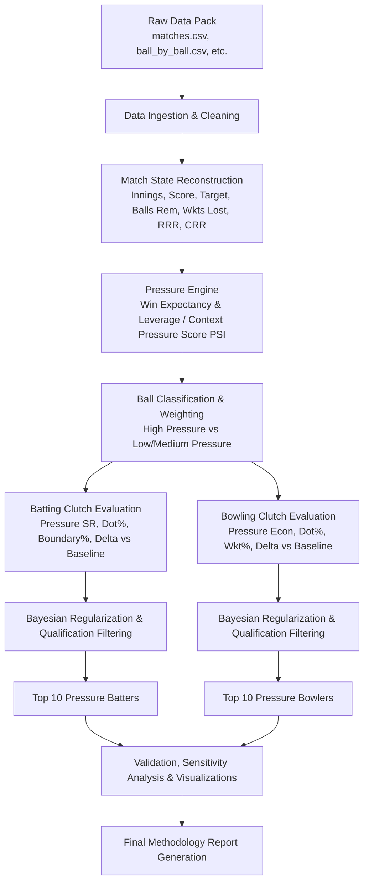

# Architecture & Technical Design Document

## 1. System Overview & Data Flow
The analytics engine is designed as a modular, reproducible quantitative pipeline that processes ball-by-ball records, constructs match-state context features, quantifies situational pressure, evaluates player performance deviations, and aggregates rankings.



---

## 2. Core Methodological Components

### 2.1 Match-State Reconstruction
For every ball $(m, i, b)$:
- Cumulative innings runs, balls elapsed, legal balls remaining ($B_{\text{rem}}$).
- Current wickets fallen ($W_{\text{lost}}$) and wickets in hand ($W_{\text{hand}} = 10 - W_{\text{lost}}$).
- **Innings 1**:
  - Projected score based on current run rate and historical resource curves (Frank Duckworth / T20 par tables).
  - Over phase: Powerplay (overs 1-6), Middle (7-15), Death (16-20).
  - Resource loss shocks (e.g., losing 3 wickets in powerplay vs cruising at 60/0).
- **Innings 2**:
  - Target ($T$), runs required ($R_{\text{req}} = T - R_{\text{curr}}$).
  - Required Run Rate ($\text{RRR} = \frac{R_{\text{req}}}{B_{\text{rem}} / 6}$).
  - Differential: $\Delta \text{RR} = \text{RRR} - \text{CRR}$.

### 2.2 The Pressure Situation Index (PSI)
Rather than an arbitrary rule (like only "last 4 overs"), pressure is modeled continuously as a function of **Leverage**:
$$\text{PSI}_{m,i,b} = f(\text{Win Probability Sensitivity}, \text{Resource Strain}, \text{Match Stakes})$$

1. **Leverage / Volatility ($L$)**:
   - The degree to which an event (boundary vs wicket vs dot) shifts the match outcome.
   - High leverage occurs when:
     - 2nd innings close chases (e.g. 30 off 18 with 4 wickets left).
     - 1st innings collapses (rebuilding while maintaining scoring rate).
     - 1st innings death overs (overs 18-20 where every dot/wicket severely dents par score).
2. **Knockout Multiplier ($K$)**:
   - Matches with `knock_out == True` or tournament finals/playoffs carry a systemic pressure weight multiplier ($1.15 \times$).
3. **Competition Quality Weighting**:
   - IPL matches and World Cup T20Is represent the peak echelon of cricket bowling/batting depth compared to bilateral series against lower-ranked teams.

### 2.3 Player Baseline vs. Pressure Performance (Clutch Metric)
To avoid simply listing the players who faced the most balls in death overs, we evaluate:
$$\text{Clutch Score} = \text{Performance}_{\text{Pressure}} - \text{Performance}_{\text{Baseline}}$$
Combined into a composite index:
- **Batter Clutch Index (BCI)**:
  - $\Delta \text{SR} = \text{SR}_{\text{pressure}} - \text{SR}_{\text{baseline}}$
  - $\Delta \text{Dot\%} = \text{Dot\%}_{\text{baseline}} - \text{Dot\%}_{\text{pressure}}$ (positive is better)
  - $\text{Dismissal Penalty / Wicket Preservation in collapses}$
  - Adjusted for opposition quality and venue par scoring rates.
- **Bowler Clutch Index (BoCI)**:
  - $\Delta \text{Econ} = \text{Econ}_{\text{baseline}} - \text{Econ}_{\text{pressure}}$ (positive is better: lower economy under pressure)
  - $\Delta \text{Wkt Rate} = \text{Wkt\%}_{\text{pressure}} - \text{Wkt\%}_{\text{baseline}}$
  - $\Delta \text{Dot\%} = \text{Dot\%}_{\text{pressure}} - \text{Dot\%}_{\text{baseline}}$

### 2.4 Reliability & Sample-Size Shrinkage (Empirical Bayes)
Small samples cause extreme outliers (e.g., a batter hitting 20 off 6 balls once has a 333 SR).
- Qualification threshold: Minimum sample of high-pressure balls faced / bowled (e.g., at least 150 pressure balls).
- Empirical Bayes shrinkage pulls low-sample estimates towards the population mean:
$$\hat{\theta}_i = \frac{N_i}{N_i + K} \bar{X}_i + \frac{K}{N_i + K} \mu_0$$
where $K$ is the shrinkage constant and $\mu_0$ is the cohort mean.

---

## 3. Tech Stack & Directory Structure
- **Environment**: Python 3.10+ in `.venv`
- **Libraries**: `pandas`, `numpy`, `scipy`, `matplotlib`, `seaborn`, `reportlab` / `weasyprint` (or markdown-to-pdf)
- **Directory Layout**:
```
RR Hackathon/
├── PRD.md
├── ARCHITECTURE.md
├── IMPLEMENTATION_PLAN.md
├── src/
│   ├── data_loader.py       # Cleans & merges datasets
│   ├── match_state.py       # Computes cumulative state (runs, balls, wickets, targets)
│   ├── pressure_model.py    # Computes PSI (Pressure Situation Index) & Leverage
│   ├── metrics_batting.py   # Batter baseline vs pressure metrics & BCI
│   ├── metrics_bowling.py   # Bowler baseline vs pressure metrics & BoCI
│   └── report_generator.py  # Visualizations & methodology report compiling
├── notebooks/               # Exploratory data analysis & validation checks
├── outputs/                 # CSV rankings, high-res plots, final report PDF
└── data_pack/               # Extracted official tournament data
```

