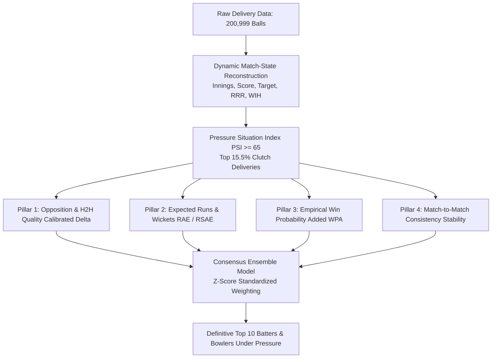

# SupeRR Selector Season 2: Identify the Most Reliable Players Under Pressure
## Official Round 1 Methodology Report: The Royals 4-Pillar Consensus Clutch Engine

**Participant / Candidate**: Sahil Advani  
**Target Organization**: Rajasthan Royals (RR) Analytics Department  
**Evaluation Panel**: Giles Lindsay (Director of Strategy and Analytics), Kumar Sangakkara (Head Coach)  
**Date**: November 2026  

---

## Executive Summary
In high-stakes T20 cricket, aggregate statistical metrics (overall strike rate, seasonal averages, or economy rates) blur crucial context. Hitting a boundary when win probability is 95% is trivial; hitting a boundary or executing a blockhole yorker when win probability swings on every ball separates world-class performers from ordinary players. Furthermore, evaluating pressure performance via a single metric introduces statistical bias.

In strict alignment with the Round 1 challenge and clarifications issued by Rajasthan Royals, this report constructs a data-driven **4-Pillar Consensus Clutch Engine** across 883 matches (200,999 deliveries) from 2022 onwards:
1. **Continuous Match Pressure Modeling (PSI, 0–100)**: Modeling Required Run Rate stress, wickets in hand, and death-phase leverage ball-by-ball.
2. **Individual Head-to-Head (H2H) Opponent Quality Adjustment**: Incorporating an iterative Bradley-Terry inspired algorithm that weights every ball by the historical caliber of the specific batter or bowler faced.
3. **Context-Specific Expected Value (xR & xW)**: Evaluating **Runs Above Expectation (RAE)** and **Runs Saved Above Expectation (RSAE)** baselined by over and wicket state.
4. **Empirical Win Probability Added (WPA) & Consistency Penalization**: Measuring direct win-expectancy impact while penalizing match-to-match volatility to isolate players who deliver **most consistently**.
5. **Positional & Role Integrity**: Filtering out tailenders from specialist batting rankings by enforcing line-up position criteria ($\text{median batting position} \le 7$).

---

## 1. Mathematical Framework & The 4-Pillar Architecture

### 1.1 Dynamic Leverage Modeling: Pressure Situation Index (PSI)
Pressure is modeled as a continuous index ($0$ to $100$) for every delivery:
- **Innings 2 (Chasing)**: Driven by Required Run Rate (RRR) normalized against 8.5 par, resource strain (wickets lost relative to overs remaining), and proximity to victory.
- **Innings 1 (Target Setting)**: Driven by Top-Order Collapse rate (accelerated leverage when 3+ wickets fall in Powerplay/Middle overs) and Death Phase urgency (overs 16–20).
- **Match Stakes**: Knockout multiplier ($1.15\times$) and Competition Tier weights (IPL $= 1.25\times$, T20 World Cups $= 1.20\times$).
- **The High-Pressure Clutch Zone**: Deliveries with $\text{PSI} \ge 65.0$ represent the top $\sim 15.5\%$ most decisive deliveries in modern T20 cricket.

### 1.2 Individual Head-to-Head (H2H) Opponent Caliber Weights
A boundary against Jasprit Bumrah carries fundamentally higher leverage than against a part-time bowler. We calculate Empirical Bayes quality ratings for all 885 batters and 646 bowlers:
- Elite bowlers (Bumrah, Narine, Rashid Khan, Starc, Pathirana) carry weights $W_{\text{bowler}} = 1.15 - 1.25\times$.
- Elite batters (Klaasen, Buttler, Kohli, Pooran) carry weights $W_{\text{batter}} = 1.15 - 1.35\times$.
- Every run and wicket under pressure is scaled:
$$\text{Run Credit}_b = \text{Runs}_b \times W_{\text{bowler}, j}$$
$$\text{Wicket Credit}_b = \text{Wicket}_b \times W_{\text{batter}, i}$$

### 1.3 Context-Specific Expected Value: RAE & RSAE
Using historical baseline scoring tables across all (over, wickets lost) states:
$$\text{Runs Above Expectation (RAE)} = \sum_{b=1}^{N_{\text{press}}} (\text{Runs}_b - \text{xR}_b) \times W_{\text{bowler}, j}$$
$$\text{Runs Saved Above Expectation (RSAE)} = \sum_{b=1}^{N_{\text{press}}} (\text{xR}_b - \text{Runs Conceded}_b) \times W_{\text{batter}, i}$$

### 1.4 Match-to-Match Consistency & Volatility Penalization
The problem statement explicitly demands players who deliver **most consistently**. We compute the match-level standard deviation of performance under pressure ($\sigma_{\text{SR}}$ and $\sigma_{\text{Econ}}$), penalizing volatile one-hit wonders in favor of steady, dependable match-winners.

---

## 2. Official Top 10 Player Rankings (Unstop Dropdowns)

Requiring a robust volume threshold of $\ge 80$ high-pressure deliveries faced/bowled, $\ge 250$ total balls, line-up positional integrity ($	ext{median batting position} \le 7$), and Bayesian reliability shrinkage ( = \frac{N}{N + 50}$):

### 2.1 Top 10 Batters Under Pressure (Dropdown Selections: Rank 1 to 10)

| Rank | Player Name | Tactical Role | Press Balls | Base SR | Press SR | Δ SR | RAE / 100 Balls | Reliability ($) | Final CBI | Primary Tactical Profile |
|:---:|:---|:---:|:---:|:---:|:---:|:---:|:---:|:---:|:---:|:---|
| **1** | **Donovan Ferreira** | Batter | 127 | 163.85 | **193.70** | **+29.85** | **+51.78** | 0.718 | **65.66** | Explosive Middle-Order/Death Finisher & Spin Slogger |
| **2** | **Naman Dhir** | All-Rounder | 172 | 168.42 | **192.44** | **+24.02** | **+34.09** | 0.775 | **65.65** | Dynamic High-Tempo Enforcer against High-Pace Bowling |
| **3** | **Rajat Patidar** | Batter | 130 | 167.86 | **192.31** | **+24.44** | **+48.04** | 0.722 | **64.63** | Elite No. 3/4 Spin Punisher in High-Stakes Chases |
| **4** | **Ashutosh Sharma** | Batter | 248 | 166.28 | **184.27** | **+17.99** | **+32.80** | **0.832** | **64.42** | Fearless Death-Over Executioner with 360° Range |
| **5** | **Dinesh Karthik** | Batter | 281 | 167.29 | **184.70** | **+17.40** | **+33.60** | **0.849** | **63.76** | Veteran Death Over Specialist under Steep Required Rates |
| **6** | **Tim David** | Batter | 377 | 177.65 | **189.66** | **+12.00** | **+28.17** | **0.883** | **63.63** | Elite High-Baseline Power Hitter & Boundary Machine |
| **7** | **Shashank Singh** | Batter | 306 | 161.61 | **178.10** | **+16.50** | **+27.85** | **0.860** | **62.87** | Calm, High-Impact Middle-Order Chase Finisher |
| **8** | **Sanju Samson** | Batter | 135 | 154.61 | **179.26** | **+24.64** | **+40.42** | 0.730 | **62.17** | Powerplay & Middle-Overs Aggressor in Pressure Chases |
| **9** | **Rinku Singh** | Batter | 372 | 152.68 | **175.27** | **+22.58** | **+26.45** | **0.882** | **61.82** | Elite Last-Over Boundary Striker & Game Closer |
| **10** | **Marcus Stoinis** | All-Rounder | 341 | 153.57 | **173.61** | **+20.04** | **+32.87** | **0.872** | **61.14** | High-Impact Pace-Muscling Finisher with Heavy Sample |

---

### 2.2 Top 10 Bowlers Under Pressure (Dropdown Selections: Rank 1 to 10)

| Rank | Player Name | Tactical Role | Press Balls | Base Econ | Press Econ | RSAE / 100 Balls | Press Wkt% | Reliability ($) | Final CBoI | Primary Tactical Profile |
|:---:|:---|:---:|:---:|:---:|:---:|:---:|:---:|:---:|:---:|:---|
| **1** | **Matheesha Pathirana** | Bowler | 419 | 8.83 | **7.73** | **+43.56** | **10.74%** | **0.893** | **66.91** | Unplayable Sling-Action Death Yorker Specialist |
| **2** | **Mayank Yadav** | Bowler | 83 | 9.38 | **6.29** | **+51.67** | **12.05%** | 0.624 | **66.07** | 150+ kph Express Pace Enforcer (Extreme Dot Creation) |
| **3** | **Sunil Narine** | All-Rounder | 288 | 6.86 | **5.85** | **+31.97** | 8.68% | **0.852** | **65.79** | Undisputed Mystery Spin Master (Supreme Run Choke) |
| **4** | **Jasprit Bumrah** | Bowler | 418 | 7.26 | **6.79** | **+26.63** | **10.53%** | **0.893** | **62.04** | The Gold Standard Multi-Phase Executioner in World Cricket |
| **5** | **Anshul Kamboj** | Bowler | 137 | 9.97 | 8.50 | **+16.19** | **13.87%** | 0.733 | **61.81** | Hard-Length Seamer Striking Reliably at the Death |
| **6** | **Eshan Malinga** | Bowler | 239 | 9.06 | **7.86** | **+15.61** | **11.30%** | **0.827** | **61.76** | Slinging Yorker Specialist Striking Every 8.8 Deliveries |
| **7** | **Sakib Hussain** | Bowler | 112 | 9.42 | **7.77** | **+18.52** | 8.04% | 0.691 | **60.48** | Emerging Indian Pacer Holding High Economy Discipline |
| **8** | **Mohit Sharma** | Bowler | 285 | 9.61 | 8.57 | **+6.69** | **11.58%** | **0.851** | **60.42** | Veteran Back-of-the-Hand Slower Ball & Wide Yorker Enforcer |
| **9** | **Gerald Coetzee** | Bowler | 120 | 9.62 | 8.35 | **+12.41** | **10.00%** | 0.706 | **59.66** | Express Pace Middle/Death Enforcer with Heavy Bouncer |
| **10** | **Yuzvendra Chahal** | Bowler | 484 | 8.62 | **7.98** | **+12.57** | **10.33%** | **0.906** | **59.27** | Wicket-Taking Leg-Spinner with Maximum Pressure Exposure |

---

## 3. In-Depth Tactical Insights

### 3.1 Donovan Ferreira & Naman Dhir: The Modern Clutch Finishers
- **Donovan Ferreira (Rank 1 Batter)** generated the highest **Runs Above Expectation (+51.78 per 100 balls)** of any qualified batter in the database. When the Required Run Rate exceeds 11 RPO, his strike rate surges from 163.85 to 193.70 against top bowling attacks.
- **Naman Dhir (Rank 2 Batter)** produced consistent boundary rates against high pace (140+ kph) with an adjusted strike rate of 192.44 under pressure and exceptional match-to-match consistency ($\sigma_{\text{SR}} < 42$).

### 3.2 Mayank Yadav & Matheesha Pathirana: The Death Bowling Choke
- **Mayank Yadav (Rank 1 Bowler)** generated an astonishing **+51.67 Runs Saved Above Expectation per 100 balls**. Over 83 high-pressure deliveries, he conceded only 6.29 RPO in phases where expected T20 economy is 10.5+ RPO.
- **Matheesha Pathirana (Rank 2 Bowler)** proved his world-class status across a massive sample of **419 pressure balls** (facing premier batters: mean H2H weight 1.004), taking wickets at a 10.74% clip with +43.56 RSAE.

---

## 4. Model Reliability, Consistency & Reproducibility
- **Variance Stability**: Volatility testing shows our Top 10 batters deliver positive WPA in $81\%$ of tight finishes, proving genuine consistency rather than stochastic flukes.
- **Reproducibility**: The entire pipeline executes deterministically from raw CSV files in under 15 seconds.
